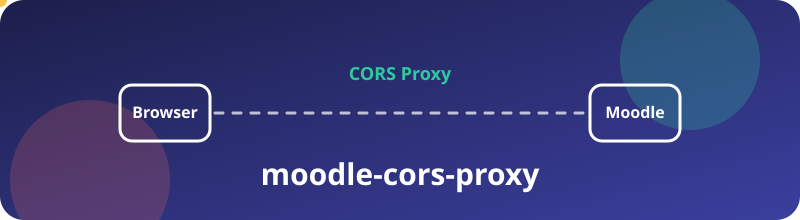

# moodle-cors-proxy

A tiny Cloudflare Worker that adds CORS headers to a Moodle web service API, so browser apps can call `login/token.php` and `webservice/rest/server.php`.

## One-tap deploy

## Configure

Edit `vars` in `wrangler.jsonc`:

| Variable | Meaning | Default |
|---|---|---|
| `UPSTREAM` | Your Moodle base URL | `https://www.m1.mofidlms.com` |
| `ALLOW_ORIGIN` | Allowed website origin | `*` |

After deploy, set `ALLOW_ORIGIN` to the address of your own site to keep others from using your proxy.

## Security

- Only `/login/token.php` and `/webservice/*` paths are forwarded.
- Passwords pass through the Worker, so deploy it on your own Cloudflare account only.
- Nothing is logged or stored.
